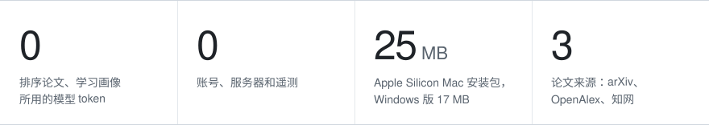
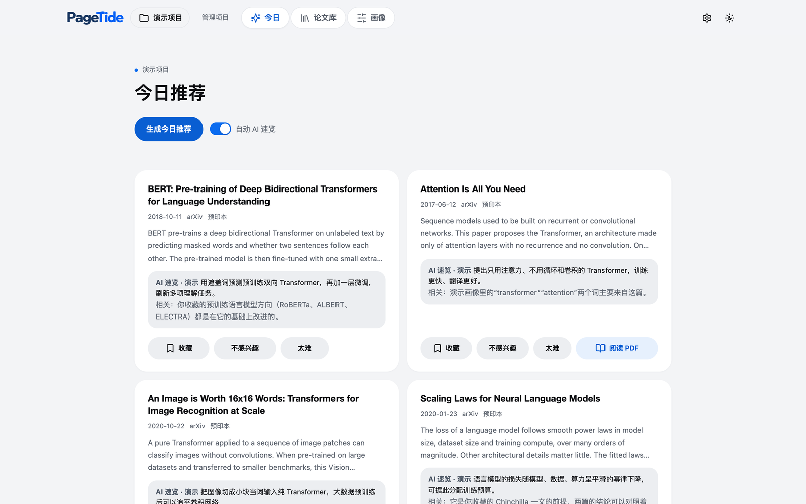
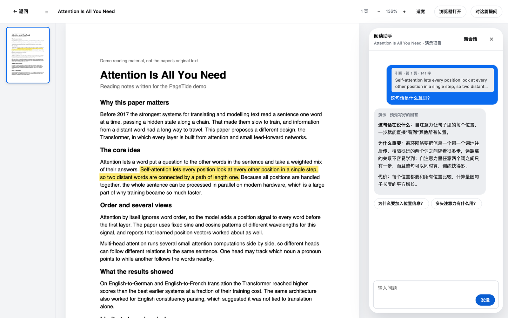
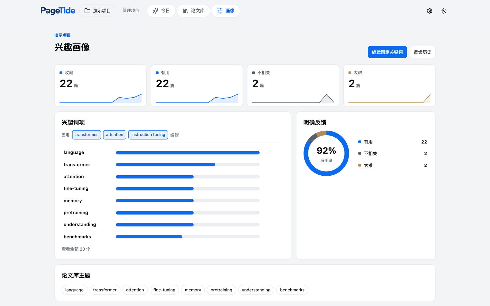
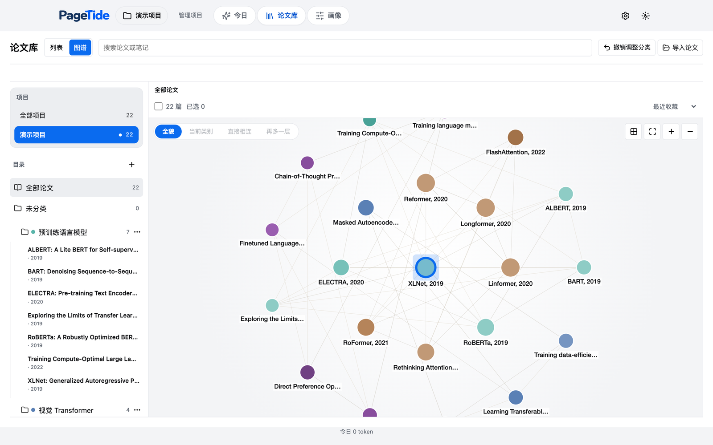
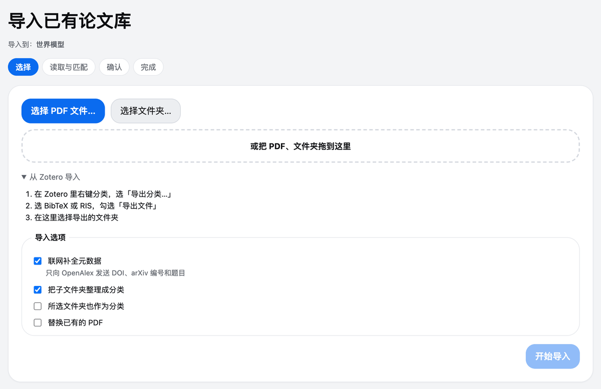
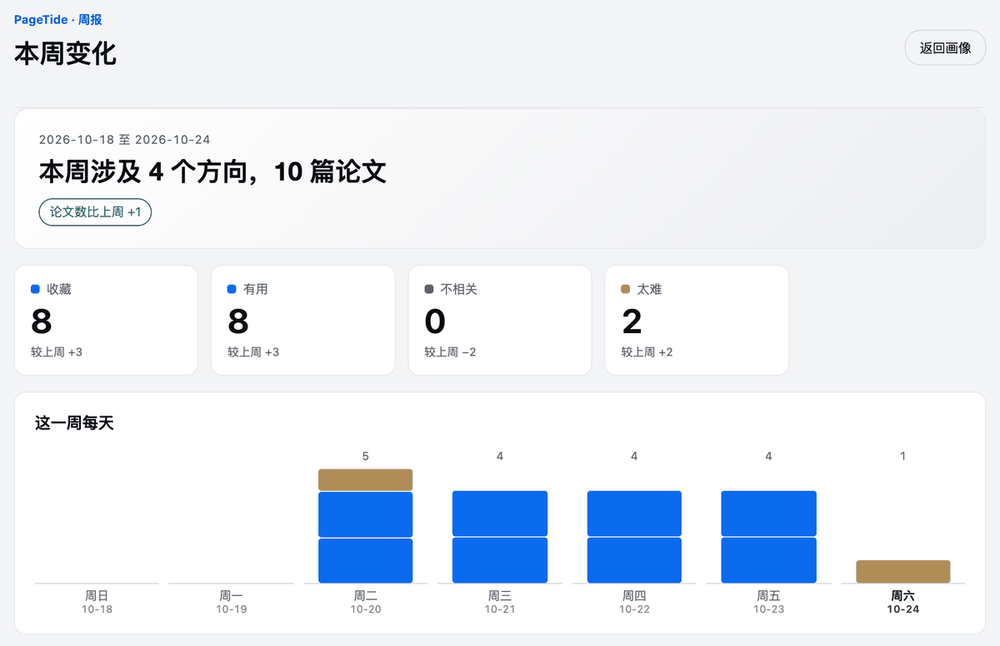

<!-- 与 README.md 保持同步 -->

<picture>
  <source media="(prefers-color-scheme: dark)" srcset="app/static/wordmark-dark.png">
  <source media="(prefers-color-scheme: light)" srcset="app/static/wordmark.png">
  
</picture>

**开源的论文发现与管理助手。**

学习你的研究画像，每天推荐新论文，收进属于你自己的论文库。

轻量 &nbsp;·&nbsp; 简单 &nbsp;·&nbsp; 高效 &nbsp;·&nbsp; 开源

<a href="README.md">English</a> · 简体中文

 

**[pagetide.chandery.org](https://pagetide.chandery.org/zh/)** · 在浏览器里直接试玩画像 demo

https://github.com/user-attachments/assets/f112d8d3-b9d1-4974-911c-ac7c90770422

配乐：Pumpupthemind

**别再刷论文列表了。每天早上，只看贴合你研究的那几篇。** PageTide 每天早上检索 arXiv、OpenAlex，以及你开启后的知网，按一份你能看懂、能修改的研究画像给结果排序，再把你收藏的论文收进属于你自己的论文库。排序在你的电脑上完成，不用 AI；AI 负责讲清每篇推荐、回答你的问题。

## 数字说话

<picture>
  <source media="(prefers-color-scheme: dark)" srcset="docs/assets/readme/numbers-band-zh-dark.svg">
  
</picture>

排序在你的电脑上完成，不用 AI。安装包大小以当前发布版为准。

## 功能

**每日推荐，附带讲解。** 每天早上按你的画像排好一小份新论文。每张卡片都有一句 AI 速览：这篇讲了什么、和你有什么关系。觉得有用就收藏，不想看就点**不感兴趣**或**太难**，一键完成。

**看得懂、改得了的画像。** 不是黑箱。每篇推荐背后的关键词都摆在眼前，你可以钉住关键词、删掉标签、撤销任何一次反馈。它只从你明确的操作里学习：什么都不做不算不喜欢，“太难”也不算不喜欢。

**会自己连起来的论文库。** 收藏的论文自动整理成列表和关联图谱，开放获取的 PDF 会下载到本地归档。AI 可以建议分类，但要你确认才会生效，每次改动都能撤销。

**划一句，问一句，读明白。** 在 PageTide 里直接读 PDF，选中看不懂的句子，翻译或追问，回答就出现在页面旁边。

**已有的论文直接带过来。** 导入 PDF 文件或整个文件夹（子文件夹自动变成分类），或从 Zotero 导出的 BibTeX、RIS。

**每周周报**，看你收藏了什么、跳过了什么、哪些方向在变强。另外还有离线演示项目和新手指引、中英文界面、亮暗主题和应用内更新。

<table>
<tr>
<td width="50%"></td>
<td width="50%"></td>
</tr>
<tr>
<td align="center">今日推荐，每篇附一句 AI 速览</td>
<td align="center">选中一句话提问，回答就在页面旁边</td>
</tr>
<tr>
<td width="50%"></td>
<td width="50%"></td>
</tr>
<tr>
<td align="center">看得懂的画像：关键词、钉词和反馈记录</td>
<td align="center">论文库自动连成关联图谱</td>
</tr>
<tr>
<td width="50%"></td>
<td width="50%"></td>
</tr>
<tr>
<td align="center">导入 PDF 文件夹或 Zotero 导出</td>
<td align="center">每周周报，看画像怎么变</td>
</tr>
</table>

## 接入服务

开箱即可使用 arXiv。想要更多数据源和 AI 功能，填入你自己的密钥，或打开知网即可。全部可选，都在 **设置** 里。

| 服务 | 用来做什么 | 密钥 | 去哪里获取 |
| --- | --- | --- | --- |
| **DeepSeek** | AI 速览、追问、划词翻译、AI 引导建项目、AI 分类建议 | 需要你自己的 API 密钥 | [platform.deepseek.com/api_keys](https://platform.deepseek.com/api_keys) |
| **arXiv** | 每天的新预印本 | 不需要 | 无 |
| **OpenAlex** | 期刊与会议论文 | 可选。免费密钥让每日额度提高约 10 倍（1000 提高到 10000 点） | [OpenAlex 密钥说明](https://help.openalex.org/api-reference/authentication) |
| **知网**（桌面应用） | 中文论文。默认关闭，在设置 → 数据源里打开。应用在自己的隐藏窗口里检索知网，每个项目最多用 3 个中文关键词，每次刷新每个项目最多 100 篇新论文。知网弹出滑块拼图时，窗口会出现，请你自己滑一下；PageTide 从不自动通过。知网的 PDF 需要你自己下载。 | 不需要 | 无 |

> [!NOTE]
> 所有密钥都由你自己在设置里填写。密钥保存在 PageTide 数据文件夹里的本地文件中，不写进设置文件，每个密钥只发给它所属的服务。PageTide 没有自己的服务器。

## 上手指南

1. **下载**适合你系统的 PageTide（见[下载](#下载)），打开它。
2. **选界面语言和外观**，跟着新手指引在演示项目里走一遍。全程离线，不需要任何密钥。
3. **新建项目**：快速创建（一句话，一次 AI 调用）、AI 引导（和 AI 聊到关键词满意为止）或手动创建（不用 AI）。
4. **在设置里填密钥**，开启 AI 功能和更多数据源（见[接入服务](#接入服务)）。
5. **点“生成今日推荐”。** 收藏喜欢的，标记不要的，看着画像一点点变准。

## 隐私优先

> [!NOTE]
> - 论文、画像和笔记只保存在你的电脑上。
> - 无需账号，无遥测，无云同步。
> - 推荐、画像和论文库离线运行，不消耗模型 token。
> - AI 功能可选，使用你自己的 DeepSeek 密钥。

## 下载

| 平台 | 文件 |
| --- | --- |
| macOS（Apple Silicon） | [`PageTide-macos-arm64.zip`](https://github.com/Chandery/PageTide/releases/latest) · 25 MB |
| macOS（Intel） | [`PageTide-macos-x64.zip`](https://github.com/Chandery/PageTide/releases/latest) · 26 MB |
| Windows（x64） | [`PageTide_<version>_x64-setup.exe`](https://github.com/Chandery/PageTide/releases/latest) · 17 MB |

首次打开：应用未签名

PageTide 是独立开源项目，没有购买付费的代码签名证书，所以系统第一次会给出提示。

- **macOS：** 解压后把 PageTide 拖进“应用程序”，右键点它选择“打开”；或到“系统设置 → 隐私与安全性”点“仍要打开”。如果提示“已损坏”，在终端运行 `xattr -dr com.apple.quarantine /Applications/PageTide.app`。
- **Windows：** SmartScreen 提示“已保护你的电脑”时，点“更多信息”，再点“仍要运行”。安装为当前用户，不需要管理员权限。

## 常见问题

<b>我的数据存在哪里？</b>

只在你的电脑上。macOS 是 `~/Library/Application Support/PageTide`，Windows 是 `%LOCALAPPDATA%\PageTideData`。设置的“存储与导出”里也会显示这个路径，并且可以导出全部数据。

<b>不填 DeepSeek 密钥能用吗？</b>

能。推荐、画像、论文库、导入和 PDF 归档都离线运行，不消耗模型 token。密钥只是多开 AI 速览、追问、翻译、AI 引导建项目和分类建议。

<b>AI 功能要花多少钱？</b>

你用自己的密钥，直接按 DeepSeek 的价格向 DeepSeek 付费。PageTide 只发送每项功能需要的文本（从不上传整个论文库），把每次请求的 token 用量记在设置的“AI 用量记录”里，一个开关就能关掉 AI。

<b>能找中文论文吗？</b>

能。创建项目时勾选“中文”作为论文语言，再在设置 → 数据源里打开知网；也可以只用 OpenAlex。知网偶尔会要你滑一下拼图，它的 PDF 需要你自己下载。

<b>怎么更新？</b>

PageTide 会自己检查更新并弹出提示，也可以在设置里点“检查更新”。

## 参与贡献

**欢迎任何形式的贡献。** 发现了 bug？有新想法？看到错别字，或想翻译某个界面？提个 [Issue](https://github.com/Chandery/PageTide/issues) 或发个 Pull Request 就行。不用是专家，小修小补和新功能一样受欢迎。

- **报告 bug、提功能建议：** [提交 Issue](https://github.com/Chandery/PageTide/issues)。附上截图会很有帮助，记得别贴出 API 密钥。
- **改进文档或翻译：** 直接改，然后开 PR。
- **写代码：** 较大的改动请先开 Issue，把方向聊一聊。本地运行、测试和构建命令都在 [CONTRIBUTING.md](CONTRIBUTING.md)。

如果 PageTide 帮你省了时间，在 GitHub 上点个 Star，能让更多研究者发现它。

## 致谢

Thank you to arXiv for use of its open access interoperability. PageTide 还使用了 [OpenAlex](https://openalex.org)、[知网](https://www.cnki.net)、[Tauri](https://tauri.app)、[pdf.js](https://mozilla.github.io/pdf.js/)、[Cytoscape.js](https://js.cytoscape.org)、[KaTeX](https://katex.org)、[NetworkX](https://networkx.org) 和 [Lucide](https://lucide.dev)。宣传视频配乐来自 Pumpupthemind。

## 许可证

[MIT](LICENSE) © Chandery
