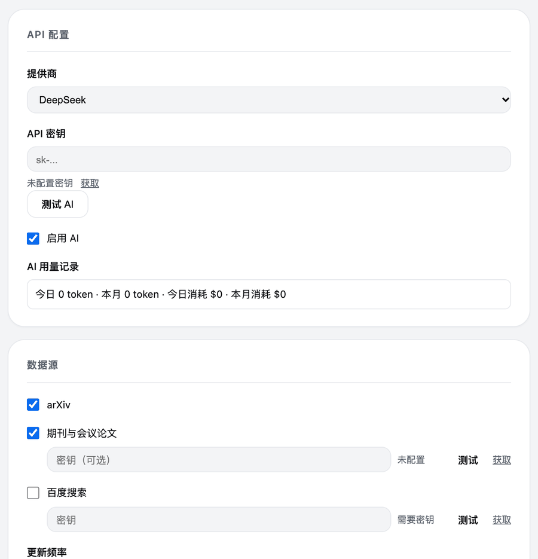
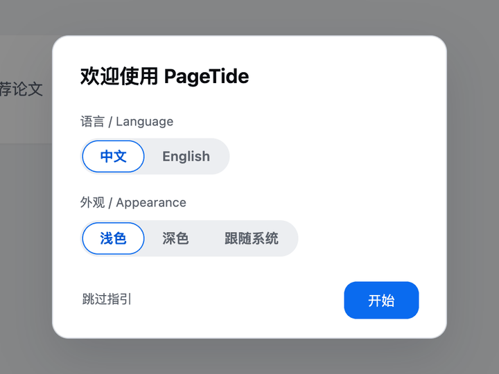
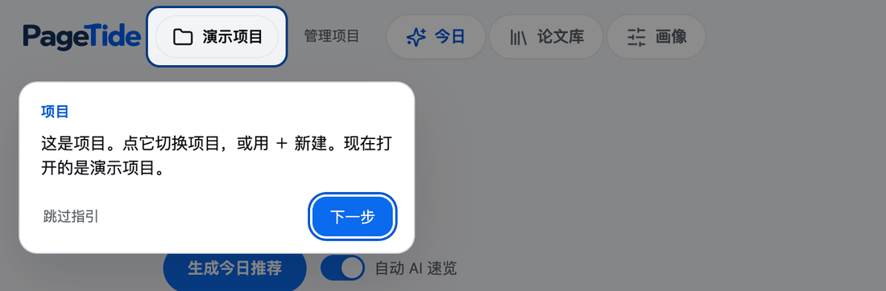
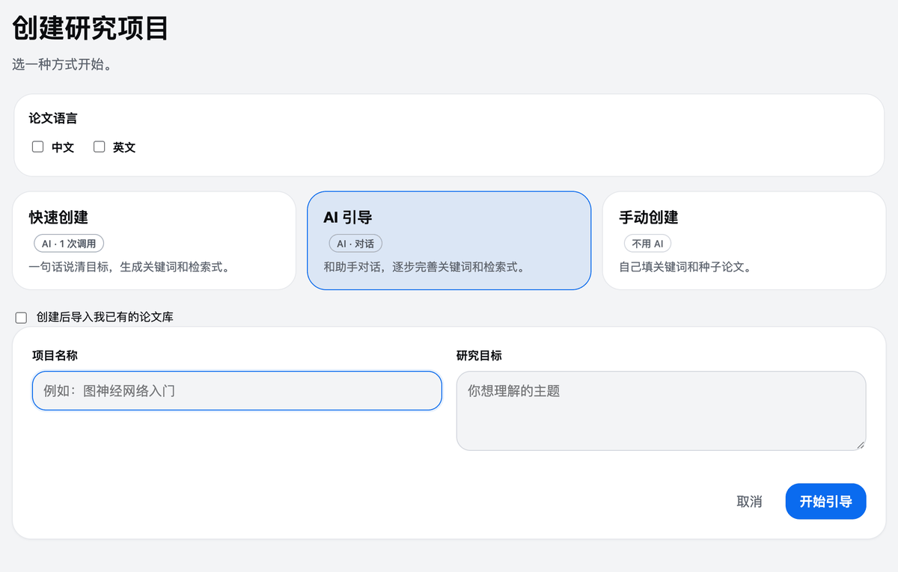

<!-- 与 README.md 保持同步 -->

<picture>
  <source media="(prefers-color-scheme: dark)" srcset="app/static/wordmark-dark.png">
  <source media="(prefers-color-scheme: light)" srcset="app/static/wordmark.png">
  
</picture>

📚 **开源的论文发现与管理助手。** 🌊

学习你的研究画像，每天推荐新论文，收进属于你自己的论文库。

🪶 轻量 &nbsp;·&nbsp; ⚡ 简单 &nbsp;·&nbsp; 🚀 高效 &nbsp;·&nbsp; 🌊 开源

<a href="README.md">English</a> · 简体中文

https://github.com/user-attachments/assets/7897ab24-b2d3-4a2c-b658-a51cfc40690b

🎵 配乐：Pumpupthemind

每天有两万篇新论文发表，真正与你有关的寥寥几篇。PageTide 是一个桌面应用：每天早上替你检索 arXiv、OpenAlex 和百度学术，挑出贴合你研究方向的论文，并用一句话讲清每篇说了什么。收藏好的、标记不要的，画像就越来越准。所有数据都留在你自己的电脑上。

## ✨ 功能

### 📬 醒来就有值得读的论文

每天早上，PageTide 去你选的数据源检索，按你的画像排序，只留一份短清单。每张卡片附一句 AI 速览：这篇讲了什么，和你有什么关系。

- 每天推荐几篇由你定（1 到 20 篇）
- 一键收藏，或标记“不感兴趣”“太难”
- 检索和排序都在你的电脑上完成，不消耗模型 token

---

### 🧭 看得懂，也改得了的画像

没有黑箱。画像把推荐背后的词项摊开给你看，并且只从你主动的操作里学习。

- 来源是收藏、“有用”标记、种子论文和钉住的关键词
- 没有操作不算不喜欢，“太难”也不算不喜欢
- 可以钉住关键词、删掉标签、撤销任何一次反馈
- 旧的标记会随时间淡化，画像跟着你当下的研究走

---

### 🕸️ 看清论文之间的联系

论文库不只是一堆 PDF：用列表浏览，或切到由相似论文和分类连成的关系图。

- 有开放版本的论文会下载并归档到本地
- AI 可以建议分类，但你勾选并确认之后才会生效
- 每次整理都可以撤销

---

### ✍️ 划一句，问一句，读明白

在 PageTide 里直接读 PDF。选中没看懂的句子，翻译它，或者追问一句，回答就出现在页面旁边。

- 比如问“这个方法的核心假设是什么？”
- 图表也能问
- 翻译和追问使用你自己的 DeepSeek 密钥

还有：离线演示项目、中英文界面、浅色与深色主题、应用内检查更新。

## 🔌 接入服务

开箱即可使用 arXiv。想要更多数据源和 AI 功能，填入你自己的密钥即可。全部可选，都在 **设置** 里。

| 服务 | 用来做什么 | 密钥 | 去哪里获取 |
| --- | --- | --- | --- |
| **DeepSeek** | AI 速览、追问、划词翻译、AI 引导建项目、AI 分类建议 | 需要你自己的 API 密钥 | [platform.deepseek.com/api_keys](https://platform.deepseek.com/api_keys) |
| **arXiv** | 每天的新预印本 | 不需要 | 无 |
| **OpenAlex** | 期刊与会议论文 | 可选。免费密钥让每日额度提高约 10 倍（1000 提高到 10000 点） | [OpenAlex 密钥说明](https://help.openalex.org/api-reference/authentication) |
| **百度学术** | 中文论文（设置里显示为“百度搜索”） | 需要你自己的百度千帆（Qianfan）密钥；PageTide 对它自限每天 40 次检索 | [千帆控制台](https://console.bce.baidu.com/qianfan/ais/console/apiKey) |

> [!NOTE]
> 所有密钥都由你自己在设置里填写。密钥保存在 PageTide 数据文件夹里的本地文件中，不写进设置文件，每个密钥只发给它所属的服务。PageTide 没有自己的服务器。

## 🚀 上手指南

### 1. 选语言和外观

第一次打开时选择中文或 English，以及浅色、深色或跟随系统。以后可以在设置里改。

### 2. 跟着指引走一遍

一段简短的指引会带你看一遍预先填好的演示项目。它离线运行、不需要密钥，之后可以在设置里重新查看。

### 3. 新建项目

可选 **快速创建**（一句话、一次 AI 调用）、**AI 引导**（边聊边完善关键词和检索式）或 **手动创建**（自己填关键词和种子论文，不用 AI）。

### 4. 接入服务

填入 DeepSeek 密钥即可使用 AI 功能，也可以再填 OpenAlex 或千帆密钥。见 [接入服务](#-接入服务)。

### 5. 看今日推荐，教它你的口味

点 **生成今日推荐**。喜欢的收藏，不要的标成“不感兴趣”或“太难”，画像随之更新。

### 6. 导入你已有的论文库

拖入 PDF 文件或整个文件夹（子文件夹会变成分类），或导入从 Zotero 导出的 BibTeX、RIS，也支持 CSL JSON。导入本身不使用 AI。

### 7. 边读边问

打开任意一篇论文，划选一句话，翻译或追问都行。

### 8. 每周看周报

每周一次，看你收藏了什么、跳过了什么、哪些方向在变热。

## 🔒 隐私优先

> [!NOTE]
> - 论文、画像和笔记只保存在你的电脑上。
> - 无需账号，无遥测，无云同步。
> - 推荐、画像和论文库离线运行，不消耗模型 token。
> - AI 功能可选，使用你自己的 DeepSeek 密钥。

## 📥 下载

| 平台 | 文件 |
| --- | --- |
| macOS（Apple Silicon） | [`PageTide-macos-arm64.zip`](https://github.com/Chandery/PageTide/releases/latest) |
| Windows（x64） | [`PageTide_<version>_x64-setup.exe`](https://github.com/Chandery/PageTide/releases/latest) |

首次打开：应用未签名

PageTide 是独立开源项目，没有购买付费的代码签名证书，所以系统第一次会给出提示。

- **macOS：** 解压后把 PageTide 拖进“应用程序”，右键点它选择“打开”；或到“系统设置 → 隐私与安全性”点“仍要打开”。如果提示“已损坏”，在终端运行 `xattr -dr com.apple.quarantine /Applications/PageTide.app`。
- **Windows：** SmartScreen 提示“已保护你的电脑”时，点“更多信息”，再点“仍要运行”。安装为当前用户，不需要管理员权限。

## ❓ 常见问题

<b>我的数据存在哪里？</b>

只在你的电脑上。macOS 是 `~/Library/Application Support/PageTide`，Windows 是 `%LOCALAPPDATA%\PageTideData`。设置的“存储与导出”里也会显示这个路径，并且可以导出全部数据。

<b>不填 DeepSeek 密钥能用吗？</b>

能。推荐、画像、论文库、导入和 PDF 归档都离线运行，不消耗模型 token。密钥只是多开 AI 速览、追问、翻译、AI 引导建项目和分类建议。

<b>AI 功能要花多少钱？</b>

你用自己的密钥，直接按 DeepSeek 的价格向 DeepSeek 付费。PageTide 只发送每项功能需要的文本（从不上传整个论文库），把每次请求的 token 用量记在设置的“AI 用量记录”里，一个开关就能关掉 AI。

<b>能找中文论文吗？</b>

能。创建项目时勾选“中文”作为论文语言，再为百度学术填入千帆密钥；也可以只用 OpenAlex。

<b>怎么更新？</b>

PageTide 会自己检查更新并弹出提示，也可以在设置里点“检查更新”。

## 🤝 参与贡献

**欢迎任何形式的贡献。** 发现了 bug？有新想法？看到错别字，或想翻译某个界面？提个 [Issue](https://github.com/Chandery/PageTide/issues) 或发个 Pull Request 就行。不用是专家，小修小补和新功能一样受欢迎。

- **报告 bug、提功能建议：** [提交 Issue](https://github.com/Chandery/PageTide/issues)。附上截图会很有帮助，记得别贴出 API 密钥。
- **改进文档或翻译：** 直接改，然后开 PR。
- **写代码：** 较大的改动请先开 Issue，把方向聊一聊。本地运行、测试和构建命令都在 [CONTRIBUTING.md](CONTRIBUTING.md)。

如果 PageTide 帮你省了时间，在 GitHub 上点个 Star，能让更多研究者发现它。⭐

## 🙏 致谢

Thank you to arXiv for use of its open access interoperability. PageTide 还使用了 [OpenAlex](https://openalex.org)、百度学术、[Tauri](https://tauri.app)、[pdf.js](https://mozilla.github.io/pdf.js/)、[Cytoscape.js](https://js.cytoscape.org)、[NetworkX](https://networkx.org) 和 [Lucide](https://lucide.dev)。宣传视频配乐来自 Pumpupthemind。

## 📄 许可证

[MIT](LICENSE) © Chandery
