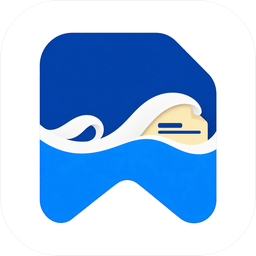
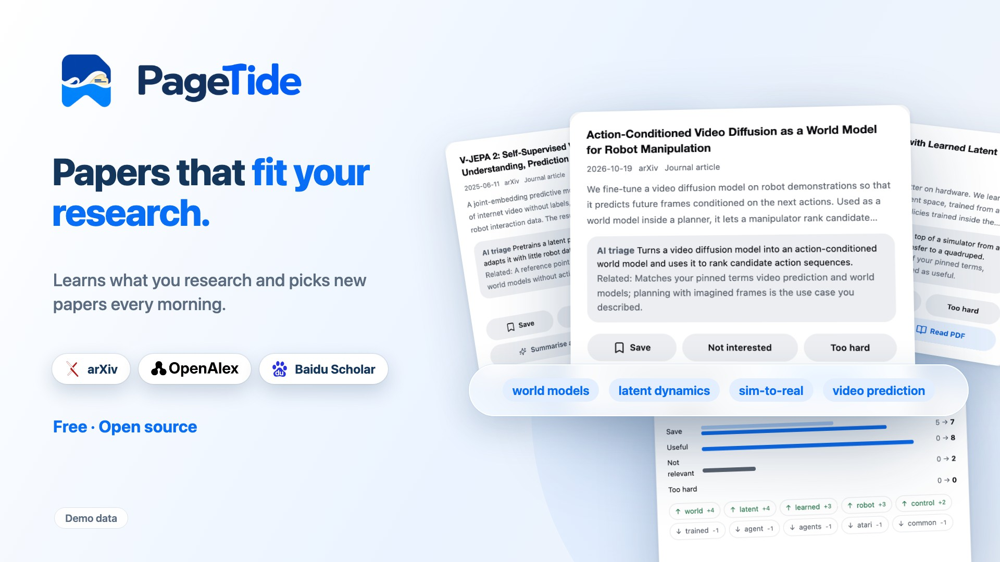
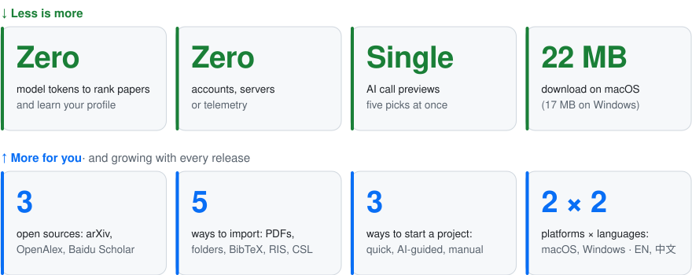
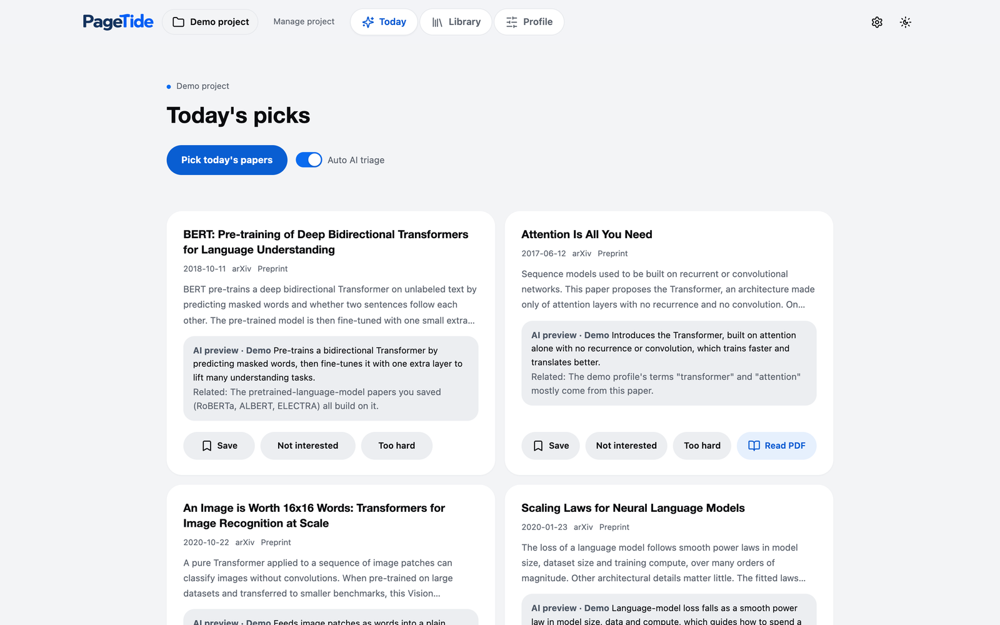
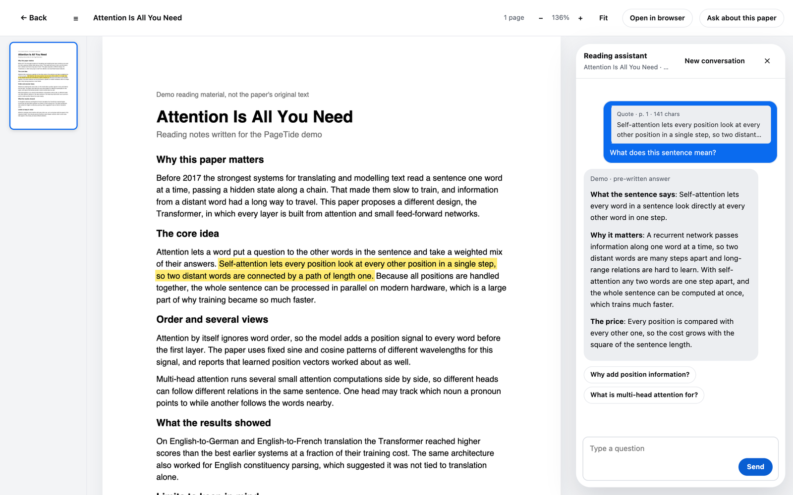
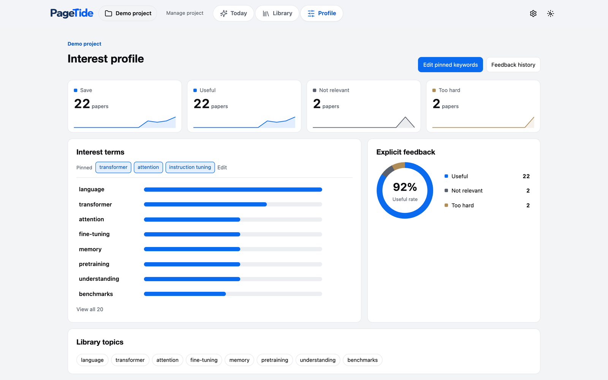
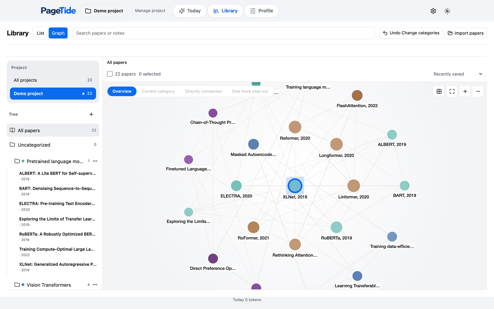
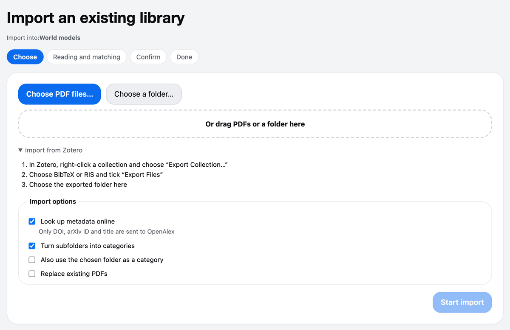
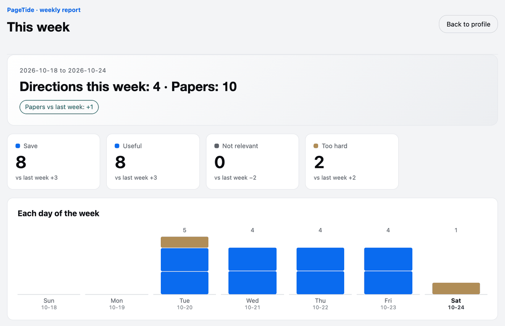

<!-- keep in sync with README-zh.md -->

<picture>
  <source media="(prefers-color-scheme: dark)" srcset="app/static/wordmark-dark.png">
  <source media="(prefers-color-scheme: light)" srcset="app/static/wordmark.png">
  
</picture>

📚 **An open-source research assistant for discovering and organizing papers.** 🌊

PageTide learns your research profile, recommends new papers every day, and keeps them in a library you own.

🪶 Lightweight &nbsp;·&nbsp; ⚡ Easy &nbsp;·&nbsp; 🚀 Efficient &nbsp;·&nbsp; 🌊 Open source

English · <a href="README-zh.md">简体中文</a>

 

🌐 **[pagetide.chandery.org](https://pagetide.chandery.org/)** · try the profile demo in your browser

https://github.com/user-attachments/assets/dbc5161f-7600-46f8-909a-9c377fb33406

🎵 Music by Pumpupthemind

**Stop scrolling feeds. Start the day with papers that fit your research.** PageTide searches arXiv, OpenAlex and Baidu Scholar every morning, ranks what it finds against a research profile you can read and edit, and keeps the papers you save in a library of your own. Ranking runs on your computer without AI; AI explains your picks and answers your questions.

## 📊 By the numbers

<picture>
  <source media="(prefers-color-scheme: dark)" srcset="docs/assets/readme/numbers-en-dark.svg">
  
</picture>

## ✨ Features

**📬 Daily picks, explained.** Each morning a short list of new papers ranked against your profile. Every card has a one-line AI preview: what the paper says and why it matters to you. Save it, or mark it **Not interested** or **Too hard** in one click.

**🧭 A profile you can read and edit.** No black box. See the terms behind every pick, pin keywords, remove tags, undo any feedback. It learns only from what you do on purpose: doing nothing never counts as a dislike, and Too hard is not a dislike either.

**🕸️ A library that connects itself.** Saved papers become a list and a graph of related work. Open-access PDFs are archived locally. AI can suggest categories, but nothing changes until you confirm, and every change can be undone.

**✍️ Highlight. Ask. Understand.** Read the PDF inside PageTide, select a sentence, then translate it or ask about it. The answer appears beside the page.

**📥 Bring what you have.** Import PDF files or folders (subfolders become categories), or a Zotero collection exported as BibTeX or RIS.

**📈 A weekly report** of what you saved, what you skipped and which directions grew, plus an offline demo project with a guided tour, English and Chinese interface, light and dark themes, and in-app updates.

<table>
<tr>
<td width="50%"></td>
<td width="50%"></td>
</tr>
<tr>
<td align="center">Today's picks, each with an AI preview</td>
<td align="center">Highlight a sentence, ask, get an answer beside the page</td>
</tr>
<tr>
<td width="50%"></td>
<td width="50%"></td>
</tr>
<tr>
<td align="center">A profile you can read: terms, pins and feedback</td>
<td align="center">Your library as a graph of related papers</td>
</tr>
<tr>
<td width="50%"></td>
<td width="50%"></td>
</tr>
<tr>
<td align="center">Import PDF folders or a Zotero export</td>
<td align="center">A weekly report of what changed</td>
</tr>
</table>

## 🔌 Connect your services

PageTide works out of the box on arXiv. Add your own keys to switch on more sources and the AI features. Everything is optional and lives in **Settings**.

| Service | Used for | Key | Get one |
| --- | --- | --- | --- |
| **DeepSeek** | AI previews, follow-up questions, selection translation, AI-guided project setup, category suggestions | Your own API key | [platform.deepseek.com/api_keys](https://platform.deepseek.com/api_keys) |
| **arXiv** | New preprints every day | None needed | n/a |
| **OpenAlex** | Journal and conference papers | Optional. A free key raises the daily allowance about 10 times (1,000 to 10,000 credits) | [OpenAlex API keys](https://help.openalex.org/api-reference/authentication) |
| **Baidu Scholar** | Chinese-language papers (listed as "Baidu Search" in Settings) | Your own Baidu Qianfan key; PageTide limits itself to 40 searches a day on it | [Qianfan console](https://console.bce.baidu.com/qianfan/ais/console/apiKey) |

> [!NOTE]
> You type every key into Settings yourself. Keys are saved in a local file inside PageTide's data folder, never in the settings file, and each key is sent only to the service it belongs to. There is no PageTide server.

## 🚀 Getting started

1. **Download** PageTide for macOS or Windows (see [Download](#-download)) and open it.
2. **Pick a language and a look**, then follow the short tour through the demo project. It is offline and needs no key.
3. **Create your project**: Quick start (one sentence, one AI call), AI guided (chat until the keywords feel right) or Manual (no AI).
4. **Add your keys** in Settings if you want AI and more sources (see [Connect your services](#-connect-your-services)).
5. **Press Pick today's papers.** Save what you like, mark the rest, and watch the profile follow.

## 🔒 Private by design

> [!NOTE]
> - Your papers, profile and notes are stored on your computer only.
> - No account, no telemetry, no cloud sync.
> - Recommendations, the profile and the library work offline and use no model tokens.
> - AI features are optional and use your own DeepSeek API key.

## 📥 Download

| Platform | File |
| --- | --- |
| macOS (Apple Silicon) | [`PageTide-macos-arm64.zip`](https://github.com/Chandery/PageTide/releases/latest) · 22 MB |
| macOS (Intel) | [`PageTide-macos-x64.zip`](https://github.com/Chandery/PageTide/releases/latest) |
| Windows (x64) | [`PageTide_<version>_x64-setup.exe`](https://github.com/Chandery/PageTide/releases/latest) · 17 MB |

First launch: the app is not signed

PageTide is an independent open-source project and has no paid code-signing certificate, so your system will warn you the first time.

- **macOS:** unzip, drag PageTide to Applications, then right-click it and choose Open. Or go to System Settings, Privacy & Security, and click Open Anyway. If macOS says the app is damaged, run `xattr -dr com.apple.quarantine /Applications/PageTide.app` in Terminal.
- **Windows:** when SmartScreen says "Windows protected your PC", click More info, then Run anyway. The installer is per-user and needs no administrator rights.

## ❓ FAQ

<b>Where is my data stored?</b>

On your computer only. On macOS it is `~/Library/Application Support/PageTide`, on Windows `%LOCALAPPDATA%\PageTideData`. The path is also shown in Settings under Storage and export, where you can export everything.

<b>Does it work without a DeepSeek key?</b>

Yes. Recommendations, the profile, the library, import and PDF archiving all work offline and use no model tokens. The key only adds AI previews, follow-up questions, translation, AI-guided setup and category suggestions.

<b>How much do the AI features cost?</b>

You pay DeepSeek directly, at DeepSeek's prices, with your own key. PageTide sends only the text each feature needs (never your whole library), records every request's token use in Settings under AI usage records, and one checkbox turns AI off.

<b>Can I use Chinese-language papers?</b>

Yes. Tick Chinese as a paper language when you create a project and add a Qianfan key for Baidu Scholar, or just use OpenAlex.

<b>How do I update?</b>

PageTide checks for updates itself and shows a banner. You can also press Check for updates in Settings.

## 🤝 Contributing

**Contributions of every kind are welcome.** Found a bug? Have an idea? Spotted a typo, or want to translate a screen? Open an [issue](https://github.com/Chandery/PageTide/issues) or send a pull request. You do not need to be an expert, and small fixes are as welcome as new features.

- **Report a bug or suggest a feature:** [open an issue](https://github.com/Chandery/PageTide/issues). Screenshots help, and please leave out any API keys.
- **Improve the docs or translations:** just edit and open a PR.
- **Write code:** for bigger changes, start with an issue so we can agree on the direction first. Setup, tests and build commands are in [CONTRIBUTING.md](CONTRIBUTING.md).

If PageTide saves you time, a star on GitHub helps other researchers find it. ⭐

## 🙏 Acknowledgments

Thank you to arXiv for use of its open access interoperability. PageTide also builds on [OpenAlex](https://openalex.org), Baidu Scholar, [Tauri](https://tauri.app), [pdf.js](https://mozilla.github.io/pdf.js/), [Cytoscape.js](https://js.cytoscape.org), [NetworkX](https://networkx.org) and [Lucide](https://lucide.dev). Promo video music by Pumpupthemind.

## 📄 License

[MIT](LICENSE) © Chandery
