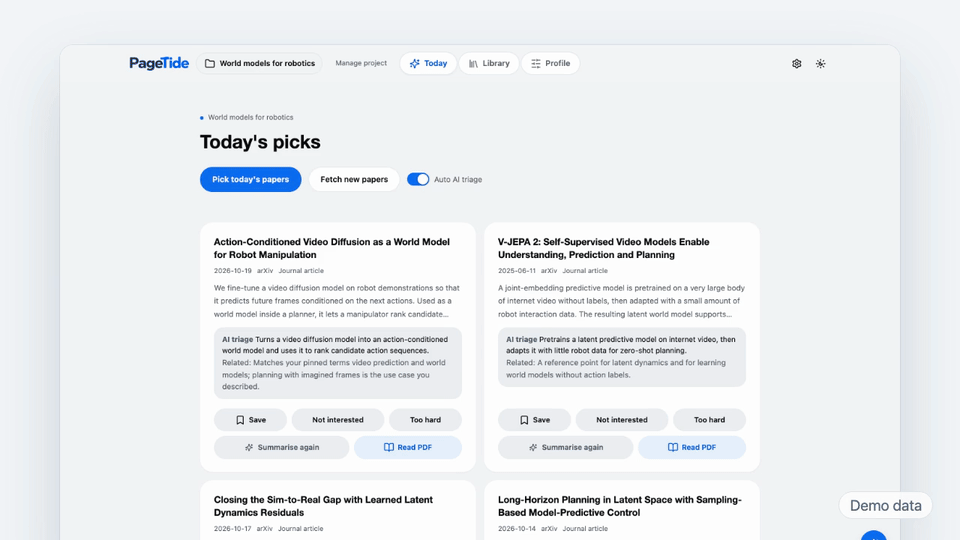

<!-- keep in sync with README-zh.md -->

<picture>
  <source media="(prefers-color-scheme: dark)" srcset="app/static/wordmark-dark.png">
  <source media="(prefers-color-scheme: light)" srcset="app/static/wordmark.png">
  
</picture>

**An open-source research assistant for discovering and organizing papers.**

PageTide learns your research profile, recommends new papers every day, and keeps them in a library you own.

Lightweight · Easy · Efficient · Open source

English · <a href="README-zh.md">简体中文</a>

Twenty thousand new papers come out every day, and only a handful matter to you. PageTide is a desktop app that searches arXiv, OpenAlex and Baidu Scholar for you each morning, picks the papers that fit what you work on, and explains each one in a line. Save the good ones, mark the rest, and your profile gets sharper. Everything stays on your computer.

## Features

<table>
<tr>
<td width="50%" valign="top">

**Daily recommendations**

Every morning, a short list of new papers that fit your project, each with a one-line AI preview of what it says and why it matters to you.

</td>
<td width="50%" valign="top">

**A profile you control**

See exactly what PageTide thinks you care about. It learns only from what you do on purpose: saving, marking not interested, pinning keywords. Edit or undo any of it.

</td>
</tr>
<tr>
<td width="50%" valign="top">

**Your library, mapped**

Browse saved papers as a list or a graph of how they connect, and let AI suggest categories to sort them into.

</td>
<td width="50%" valign="top">

**Read and ask**

Open the PDF, highlight a sentence, then translate it or ask a follow-up right beside the page.

</td>
</tr>
</table>

Also included:

- A weekly report showing how your profile changed.
- An offline demo project and a short guided tour on first launch.
- Import an existing library: PDF files and folders, or a Zotero collection exported as BibTeX or RIS.
- PDF download and archiving for papers that offer an open copy.
- English and Chinese interface, light and dark themes.
- In-app update check.

## See it in action

<!-- 30 s promo video: paste the github.com/user-attachments/... URL here on its own line (mp4 under 10 MB) -->

A 30-second walkthrough of PageTide, from creating a project to asking a question about a paper, will be embedded here.

## Private by design

> [!NOTE]
> - Your papers, profile and notes are stored on your computer only.
> - No account, no telemetry, no cloud sync.
> - Recommendations, the profile and the library work offline and use no model tokens.
> - AI features are optional and use your own DeepSeek API key.

## Download

| Platform | File |
| --- | --- |
| macOS (Apple Silicon) | [`PageTide-macos-arm64.zip`](https://github.com/Chandery/PageTide/releases/latest) |
| Windows (x64) | [`PageTide_<version>_x64-setup.exe`](https://github.com/Chandery/PageTide/releases/latest) |

First launch: the app is not signed

PageTide is an independent open-source project and has no paid code-signing certificate, so your system will warn you the first time.

- **macOS:** unzip, drag PageTide to Applications, then right-click it and choose Open. Or go to System Settings, Privacy & Security, and click Open Anyway. If macOS says the app is damaged, run `xattr -dr com.apple.quarantine /Applications/PageTide.app` in Terminal.
- **Windows:** when SmartScreen says "Windows protected your PC", click More info, then Run anyway. The installer is per-user and needs no administrator rights.

## Quick start

1. Open PageTide, pick a language and appearance, and click through the short tour on the demo project.
2. Create your own project: Quick start, AI-guided or Manual.
3. Generate today's picks, then save or mark what you see.
4. Optional: add a DeepSeek API key in Settings to turn on AI previews and follow-up questions.

## Roadmap and feedback

Ideas, bugs and requests are welcome in [Issues](https://github.com/Chandery/PageTide/issues).

## Contributing

Run from source, run the tests and build the desktop app: see [CONTRIBUTING.md](CONTRIBUTING.md).

## Acknowledgments

Thank you to arXiv for use of its open access interoperability. PageTide also builds on [OpenAlex](https://openalex.org), Baidu Scholar, [Tauri](https://tauri.app), [pdf.js](https://mozilla.github.io/pdf.js/), [Cytoscape.js](https://js.cytoscape.org), [NetworkX](https://networkx.org) and [Lucide](https://lucide.dev).

## License

[MIT](LICENSE) © Chandery
