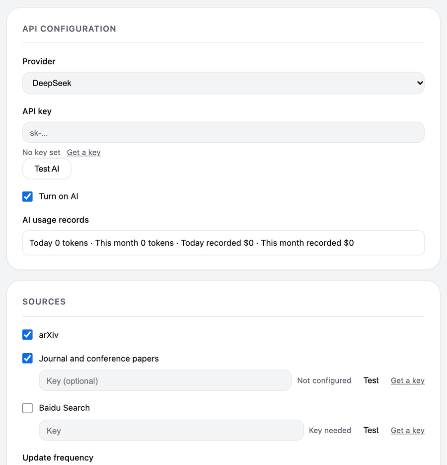
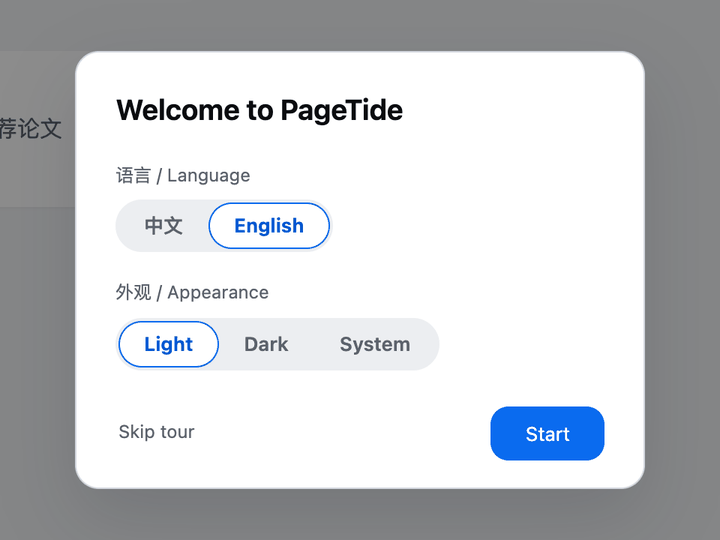
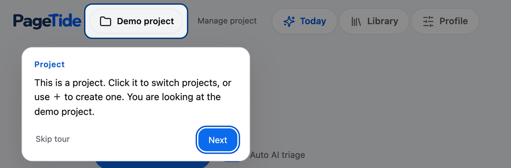
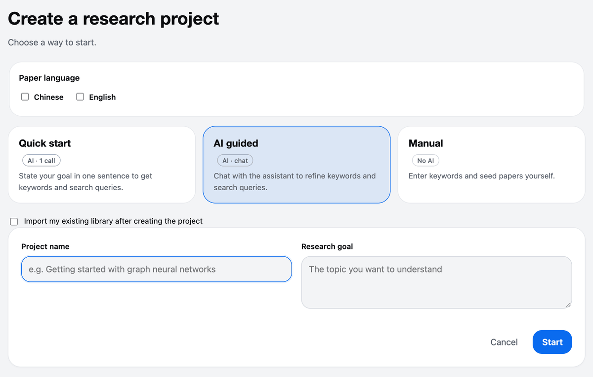

<!-- keep in sync with README-zh.md -->

<picture>
  <source media="(prefers-color-scheme: dark)" srcset="app/static/wordmark-dark.png">
  <source media="(prefers-color-scheme: light)" srcset="app/static/wordmark.png">
  
</picture>

📚 **An open-source research assistant for discovering and organizing papers.** 🌊

PageTide learns your research profile, recommends new papers every day, and keeps them in a library you own.

🪶 Lightweight &nbsp;·&nbsp; ⚡ Easy &nbsp;·&nbsp; 🚀 Efficient &nbsp;·&nbsp; 🌊 Open source

English · <a href="README-zh.md">简体中文</a>

https://github.com/user-attachments/assets/031e2f69-5985-4d31-b595-9411cec919c2

🎵 Music by Pumpupthemind

Twenty thousand new papers come out every day, and only a handful matter to you. PageTide is a desktop app that searches arXiv, OpenAlex and Baidu Scholar for you each morning, picks the papers that fit what you work on, and explains each one in a line. Save the good ones, mark the rest, and your profile gets sharper. Everything stays on your computer.

## ✨ Features

### 📬 Wake up to papers worth reading

Each morning PageTide searches your sources, ranks the results against your profile and hands you a short list. Every card carries a one-line AI preview: what the paper says and why it matters to you.

- Choose how many picks you get per day (1 to 20)
- Save, or mark **Not interested** / **Too hard** in one click
- Search and ranking run on your machine and use no model tokens

---

### 🧭 A profile you can read, and edit

No black box. The profile shows the terms behind your picks and learns only from what you do on purpose.

- Built from saves, Useful marks, seeds and pinned keywords
- Doing nothing never counts as a dislike, and Too hard is not a dislike either
- Pin keywords, remove tags, undo any feedback
- Old marks fade over time, so the profile follows your current work

---

### 🕸️ See how your papers connect

Browse your library as a list or as a graph of similar papers and categories, not just a pile of PDFs.

- Open-access papers are downloaded and archived locally
- AI can suggest categories, but nothing is applied until you tick the changes and confirm
- Every reorganization can be undone

---

### ✍️ Highlight. Ask. Understand.

Read the PDF inside PageTide. Select a sentence you do not get, then translate it or ask a follow-up. The answer appears right beside the page.

- Questions such as "What are the core assumptions of this method?"
- Ask about figures too
- Translation and questions use your own DeepSeek key

Also included: an offline demo project, English and Chinese interface, light and dark themes, and an in-app update check.

## 🔌 Connect your services

PageTide works out of the box on arXiv. Add your own keys to switch on more sources and the AI features. Everything is optional and lives in **Settings**.

| Service | Used for | Key | Get one |
| --- | --- | --- | --- |
| **DeepSeek** | AI previews, follow-up questions, selection translation, AI-guided project setup, category suggestions | Your own API key | [platform.deepseek.com/api_keys](https://platform.deepseek.com/api_keys) |
| **arXiv** | New preprints every day | None needed | n/a |
| **OpenAlex** | Journal and conference papers | Optional. A free key raises the daily allowance about 10 times (1,000 to 10,000 credits) | [OpenAlex API keys](https://help.openalex.org/api-reference/authentication) |
| **Baidu Scholar** | Chinese-language papers (listed as "Baidu Search" in Settings) | Your own Baidu Qianfan key; PageTide limits itself to 40 searches a day on it | [Qianfan console](https://console.bce.baidu.com/qianfan/ais/console/apiKey) |

> [!NOTE]
> You type every key into Settings yourself. Keys are saved in a local file inside PageTide's data folder, never in the settings file, and each key is sent only to the service it belongs to. There is no PageTide server.

## 🚀 Getting started

### 1. Pick a language and a look

On first launch, choose English or Chinese and light, dark or system. You can change both later in Settings.

### 2. Take the guided tour

A short tour walks through a pre-filled demo project. It is offline, uses no key, and you can replay it from Settings.

### 3. Create your project

Choose **Quick start** (one sentence, one AI call), **AI guided** (chat until the keywords and queries feel right) or **Manual** (type keywords and seed papers yourself, no AI).

### 4. Connect your services

Paste your DeepSeek key for AI features, and optionally an OpenAlex or Qianfan key. See [Connect your services](#-connect-your-services).

### 5. Get today's picks and teach it

Press **Pick today's papers**. Save what you like, mark the rest Not interested or Too hard, and watch the profile follow.

### 6. Bring your existing library

Drop in PDF files or a whole folder (subfolders become categories), or a Zotero collection exported as BibTeX or RIS. CSL JSON works too. Import itself uses no AI.

### 7. Read and ask

Open any paper, highlight a sentence, then translate it or ask about it.

### 8. Check the weekly report

Once a week, see what you saved, what you skipped and which directions grew.

## 🔒 Private by design

> [!NOTE]
> - Your papers, profile and notes are stored on your computer only.
> - No account, no telemetry, no cloud sync.
> - Recommendations, the profile and the library work offline and use no model tokens.
> - AI features are optional and use your own DeepSeek API key.

## 📥 Download

| Platform | File |
| --- | --- |
| macOS (Apple Silicon) | [`PageTide-macos-arm64.zip`](https://github.com/Chandery/PageTide/releases/latest) |
| Windows (x64) | [`PageTide_<version>_x64-setup.exe`](https://github.com/Chandery/PageTide/releases/latest) |

First launch: the app is not signed

PageTide is an independent open-source project and has no paid code-signing certificate, so your system will warn you the first time.

- **macOS:** unzip, drag PageTide to Applications, then right-click it and choose Open. Or go to System Settings, Privacy & Security, and click Open Anyway. If macOS says the app is damaged, run `xattr -dr com.apple.quarantine /Applications/PageTide.app` in Terminal.
- **Windows:** when SmartScreen says "Windows protected your PC", click More info, then Run anyway. The installer is per-user and needs no administrator rights.

## ❓ FAQ

<b>Where is my data stored?</b>

On your computer only. On macOS it is `~/Library/Application Support/PageTide`, on Windows `%LOCALAPPDATA%\PageTideData`. The path is also shown in Settings under Storage and export, where you can export everything.

<b>Does it work without a DeepSeek key?</b>

Yes. Recommendations, the profile, the library, import and PDF archiving all work offline and use no model tokens. The key only adds AI previews, follow-up questions, translation, AI-guided setup and category suggestions.

<b>How much do the AI features cost?</b>

You pay DeepSeek directly, at DeepSeek's prices, with your own key. PageTide sends only the text each feature needs (never your whole library), records every request's token use in Settings under AI usage records, and one checkbox turns AI off.

<b>Can I use Chinese-language papers?</b>

Yes. Tick Chinese as a paper language when you create a project and add a Qianfan key for Baidu Scholar, or just use OpenAlex.

<b>How do I update?</b>

PageTide checks for updates itself and shows a banner. You can also press Check for updates in Settings.

## 🤝 Contributing

**Contributions of every kind are welcome.** Found a bug? Have an idea? Spotted a typo, or want to translate a screen? Open an [issue](https://github.com/Chandery/PageTide/issues) or send a pull request. You do not need to be an expert, and small fixes are as welcome as new features.

- **Report a bug or suggest a feature:** [open an issue](https://github.com/Chandery/PageTide/issues). Screenshots help, and please leave out any API keys.
- **Improve the docs or translations:** just edit and open a PR.
- **Write code:** for bigger changes, start with an issue so we can agree on the direction first. Setup, tests and build commands are in [CONTRIBUTING.md](CONTRIBUTING.md).

If PageTide saves you time, a star on GitHub helps other researchers find it. ⭐

## 🙏 Acknowledgments

Thank you to arXiv for use of its open access interoperability. PageTide also builds on [OpenAlex](https://openalex.org), Baidu Scholar, [Tauri](https://tauri.app), [pdf.js](https://mozilla.github.io/pdf.js/), [Cytoscape.js](https://js.cytoscape.org), [NetworkX](https://networkx.org) and [Lucide](https://lucide.dev). Promo video music by Pumpupthemind.

## 📄 License

[MIT](LICENSE) © Chandery
